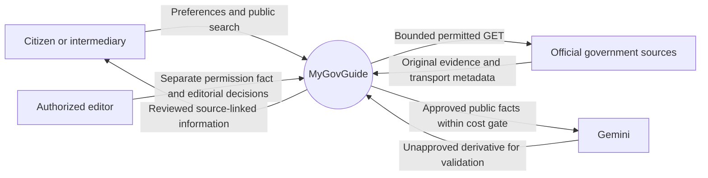
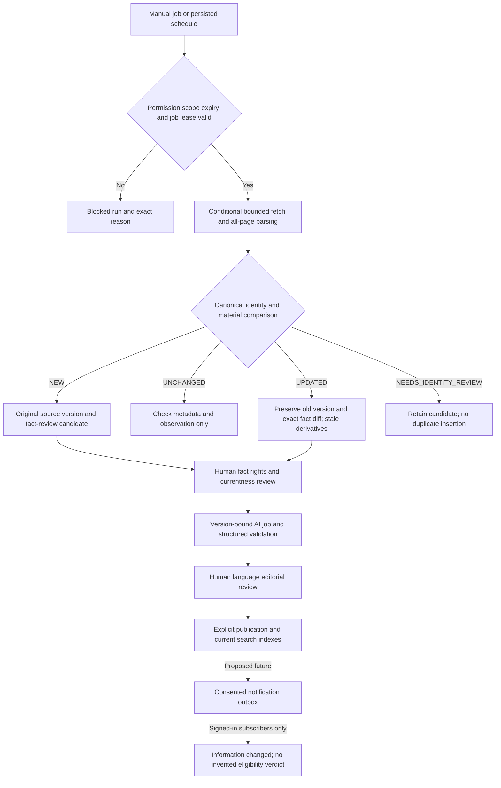
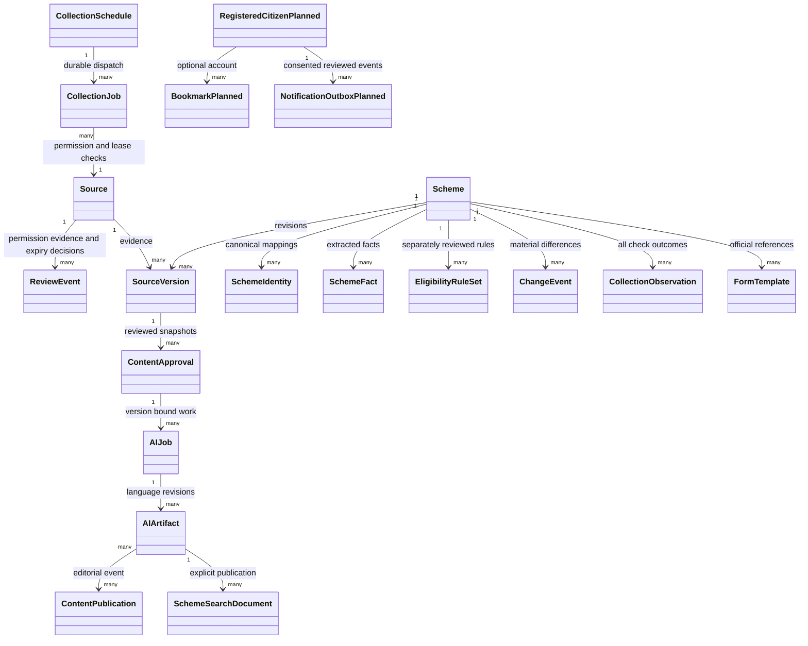

# Original SRS alignment and government-source acquisition review

19 November 2026 · Existing implementation extended in place · One consolidated audit/execution report

## Baseline and authority

Read the original 10-page Synopsis,9-page standalone SRS and complete 42-page SRS/System Design/Implementation PDF from the project’s parent directory. The additional Synopsis variant was compared: extracted body text is the same except the submitted-to name. The academic documents define the original vision; current owner-approved decisions and working code define deliberate implementation changes. [PRODUCT_MASTER_PLAN.md](../../PRODUCT_MASTER_PLAN.md) remains the current product specification, with [PROGRESS.md](../../PROGRESS.md) recording execution truth. No submitted PDF was overwritten or replaced.

| Original file | Pages | SHA-256 prefix (complete hashes retained privately) |
|---|---:|---|
| 4SO25MC112_WILSON_RODRIGUES_Synopsis_MYGOVGUIDE.pdf | 10 | f5df33abbef9ba65dc1b… |
| 4SO25MC112_WILSON_RODRIGUES_Synopsis_MYGOVGUIDE1.pdf | 10 | beaba66c9a576f243cce… |
| 4SO25MC112_WILSON_RODRIGUES_SRS_MYGOVGUIDE.pdf | 9 | ff9da5be2de2a3736927… |
| 4SO25MC112 WILSON RODRIGUES SRS TO IMPLIMENTATION.pdf | 42 | 837d276b75fd6ac3ed17… |

PDF pages below refer to the 42-page combined document. Diagrams were rendered and visually inspected, including architecture p13, context DFD p15, Level1 p17, Level2 p18 and class diagram p20. Private text/render/hash receipts are in ignored `.local/srs-acquisition/`.

## 1. Requirements and actual modules

Status meanings: **Implemented** = working code with stated tests; **Partial** = only specified portions exist; **Missing** = no working service; **Superseded** = deliberate owner-approved design replacement; **Blocked** = external access, permission, current evidence or acceptance prerequisite. A model or placeholder page alone is not a finished feature.

| Academic requirement / location | Current implementation and collections | Status / exact difference |
|---|---|---|
| Synopsis objectives 1/4; SRS3.3.1; DFD1.0 | `ProfileContext`, `PreferenceForm`, `Onboarding`, `profileController`, `AnonymousSession` | Implemented minimal state/category/language preferences and owning HttpOnly session; optional voice actions tested with injected browser events. Anonymous profile is not a registered `User`. |
| Scheme discovery/simplification; DFD2.0 | `Schemes`, `SchemeDetail`, `contentPublic`, `content/search`, `SchemeSearchDocument`, `AIArtifact` | Implemented for15 published schemes/45 approved language indexes. Raw research never appears as approved results. Search does not invoke Gemini. |
| Eligibility gap analysis; DFD3.0 / p36–37 | `EligibilityRuleSet`, rule validation in contracts/models; citizen limited-state entry | Partial schema foundation; deterministic evaluation UI/API missing, complete approved rules0. Never treat an empty rule list as “all passed”. |
| Form library and guidance; DFD4.0 / p37–38 | `FormTemplate`, importer, PDF parser;18 references | Partial storage/parser foundation; form selection, upload identification and field guidance missing. `observedFields` is not approved `FieldGuidance`. |
| Notice-to-Action; DFD5.0 / p38 | `Notice` holds official/research/feed records, not private uploaded notices | Partial public-source storage; private upload/extraction/explanation/checklist service missing. Do not reuse the public Notice collection for sensitive submissions. |
| Scam alerts; DFD6.0 / p39 | `ScamAlert`, record-type/date validation;12 awareness topics | Partial data foundation; dated reviewed public feed and personal delivery missing. Undated lessons and NDMA disaster notices are not current scam incidents. |
| Collection; DFD7.1–7.2 / p39–40 | `ingestion/access`, `http`, `collect`, adapter registry, `Source`, `AdapterConfig`, `IngestionRun` | Implemented gated engine; broad scheme-source acquisition remains blocked by source-specific permissions/access. New field-aware HTML extraction and PDF encoding warnings added. |
| Change Radar; DFD7.3–7.4 / p40–41 | `schemeIdentity`, `material`, `ingest`, `SourceVersion`, `ChangeEvent`, `CollectionObservation` | Implemented canonical identity, exact fact differences, immutable versions and four outcomes. Unchanged checks update metadata/observations while skipping content versions and AI. |
| Scheduled2–3 daily refreshes | `admin/jobs` schedulerTick/runOne, `CollectionSchedule`, `CollectionJob`, heartbeat | Implemented durable scheduling/recovery, not an activated twice-daily government crawl. Current configured schedules0; worker must run. |
| Change notifications; DFD7.5 / p41–42 | No citizen account/subscription/outbox/delivery implementation | Missing. Notifications must follow reviewed publication and opt-in, not raw scrape differences or state/category matching alone. |
| Gemini/language layer | `content/providers`, `workflow`, `contracts`, `AIJob`, `AIArtifact`, `ContentApproval` | Implemented reviewed-public-content preparation, validation, retry/defer and publication gates. Free-only restrictions retained; no model calls in this task. |
| Voice/Bhashini | `VoiceContext`, `voiceCommands`, `VoiceAssistant`, browser speech | Partial full SRS vision: current page actions exist; physical-device/native-speech acceptance and Bhashini integration not established. Manual mode always works. |
| Optional login/bookmarks | Citizen account/bookmark services absent; environment admin auth is separate | Missing citizen registration, recovery, bookmarks and follows. Admin login must not be presented as the SRS citizen account implementation. |
| Source links/original evidence | Public details, approved excerpts, `SourceVersion`, field evidence and review records | Implemented for published content; collection/source review does not certify complete operative eligibility. |
| Mobile/low-bandwidth/performance NFR3.5 | Citizen UI, trilingual fonts, responsive/contrast/browser checks | Partial acceptance:320/360/390px checks pass; original 3G/sub3-second FCP/load targets, screen-reader/native-device QA not measured here. Non-blocking bundle-size warning remains. |
| HTTPS/environment privacy NFR3.4.4/3.5 | Private backend env, cookie ownership/origin checks, pinned HTTPS source transport | Implemented development protections; localhost HTTP is not production HTTPS certification. Hosted hardening/deployment still pending. |
| Centers, fuller Home and signed-in notifications | Newer owner-approved master-plan additions; Home built, centers/accounts limited-state | Centers extend the original five actions to six. Their directory/maps, saved items and personal notifications remain missing. |
| B2B CSC/NGO, WhatsApp, RAG/knowledge graph | Explicit future scope in Synopsis/SRS | Missing by deliberate deferral, not part of this acquisition task. |

### Deliberately superseded assumptions

- Public availability is not scraper permission. myScheme expressly requires written authorization; no Puppeteer/headless/API workaround was introduced. Current SafeHttp/Cheerio/pdf-parse and registered adapters replace the assumed unrestricted Puppeteer crawl.
- The fixed `Gemini 1.5 Flash` choice is superseded by private model configuration and capability/free-usage verification. Source-grounded background generation and reviewed artifacts replace per-search generation into `scheme.simplifiedText`.
- `node-cron` as a process-only trigger is superseded by MongoDB-persisted schedules, slots and leases. Source authorization and expiry are checked before execution/commit.
- Anonymous `users.insertOrUpdate(profile)` plus a client user ID is replaced by cookie-owned anonymous sessions and minimal non-sensitive local preferences. Citizen JWT/bcrypt accounts are not implemented; environment-based admin authentication is a separate owner decision. Separate CSRF tokens were removed at the owner’s request while cookies/origin/session controls remain.
- Raw changes do not automatically approve new facts or generate “newly eligible” messages. Material changes retain evidence, invalidate stale outputs and require review. Future notifications need signed-in consent and reviewed events.
- Original broader regional-language/Bhashini aspirations remain future scope beyond current EN/HI/KN/browser speech. Vercel/Render deployment is a proposed destination, not an existing deployment.

## 2. Original DFD/class/schema defects and mapping

| Original artifact | What it depicts | Required correction / actual implementation |
|---|---|---|
| Fig4.1 p13 | Scheduler → Puppeteer → Change Radar → MongoDB/notifications | Insert permission, identity, immutable evidence, human fact review, AI job/validation and editorial publication boundaries. Current native worker already supplies the acquisition/review side. |
| Fig4.2 p15 | Government-source arrow labeled “AI request/response”; MongoDB shown in context | Relabel official-source traffic as permitted content requests/evidence; show Gemini as a distinct external actor. Keep internal stores out of a strict context DFD. Never send citizen uploads/profile data to a government feed. |
| Fig4.3 p17 / D1 | User Profiles, shared by citizen processes | Current D1 maps to anonymous sessions/preferences. Future registered accounts/subscriptions must be distinct; no invented `users` service. |
| Fig4.3 D2 | Schemes with embedded rules/summary | Current D2 spans `schemes`, `schemefacts`, `eligibilityrulesets`, versioned approvals/artifacts and published search documents. Retrieval must traverse current publication gates. |
| Fig4.3 D3 | Forms and field guidance | Current `formtemplates` contains references/observed fields. Approved field-guidance artifacts remain future work. |
| Fig4.3 D4 | Notices combine public and user uploads | Current `notices` is government/research/feed evidence. Future private SubmittedNotice/ephemeral extraction needs ownership, retention and consent, isolated from public ingestion. |
| Fig4.3 D5 | Alerts by citizen category | Current `scamalerts` separates dated advisories from awareness. Public publication and opt-in notifications still need implementation. |
| Fig4.5 p18 | Fetch→parse→compare→update→notify | Add permission gate, four identity outcomes, separate “checked”/“changed”, review queues and editorial event boundary before any future notification. Failed page traversal must not advance checkpoint. |
| Fig5.1 p20 / `User` | Phone/password account with profile | Future citizen account only. Anonymous sessions and environment-admin sessions are separate current services. |
| Fig5.1 `FormTemplate` | `userId`, although schema p31 says `schemeId` | Correct to scheme relationship; actual model supports `schemeId` and `linkedSchemeIds`. Forms are not owned by a citizen merely because they are official templates. |
| Fig5.1 `Notice` / schema | Diagram uploadId/explanationString versus schema userId/map | Resolve into public Notice versus private SubmittedNotice; define typed ActionItem/due-date evidence and explicit retention. Both designs are not already implemented. |
| Fig5.1 `Bookmark` | Simultaneous links to scheme and form | Model a typed alternative target, not both simultaneously. Future unique index `(userId,itemType,itemId)` plus ownership checks. |
| `ChangeRadarLog` / p32 | Embedded before/after snapshots | Actual `sourceversions` preserve revisions; `changeevents` link old/new versions with fact differences; `collectionobservations` preserve unchanged/review checks. No redundant full snapshot per unchanged check. |
| ObjectId schema / p30–32 | All entity IDs are ObjectId | Actual domain IDs are stable strings/UUIDs with explicit refs and validated uniqueness. Preserve them; do not recreate published IDs. |
| Embedded `simplifiedText` | Language map on Scheme is authoritative cache | Current `AIArtifact` + approval/source hash + `SchemeSearchDocument` are authoritative derived/public layers. Legacy field remains but is not a public shortcut. |
| SRS delivery schedule | Calls itself4-week but lists9 weeks | Documentation inconsistency only; neither count establishes completed deliverables. |

## 3. Proposed diagrams (review changes only, not new deployed features)

### Revised context DFD



### Revised Level2 acquisition/review DFD



Level1 retains processes1.0–7.0 for academic traceability. Process2.0 reads approved stored artifacts/indexes;3.0 remains unavailable until approved deterministic rules;4.0/5.0/6.0 remain clearly marked partial/missing. Process7.0 now decomposes into the permission/evidence/identity/review/publication stages above. Add editor as a separate actor and a distinct future notification process; do not mark future arrows implemented.

### Revised core class relationships



The proposed future database additions are registered citizen/recovery records, typed bookmarks, consented subscriptions, a publication-event outbox and delivery/dedup state, plus private ephemeral upload/extraction records where needed. They are not present current implementations. Source permissions, immutable versions, approvals, AI jobs/artifacts, public indexes, observations and jobs/schedules already exist and must be reused.

## 4. Pseudocode comparison and proposed corrections

| Original algorithm | Current module / proposed correction |
|---|---|
| saveOnboardingProfile p34 | `profileController` + `ProfileContext`: validate state/category/language; use owning HttpOnly cookie; synchronize only minimal preferences. User-activated voice and manual editing share state. Never trust a client-supplied user ID. |
| searchSchemes p35 | `content/search.searchContent/readPublished`: indexed normalized language tokens and current publication gates; return stored approved language or explicit fallback. Do not create/simplify AI content on a query. |
| checkEligibility p36–37 | Missing evaluator. Proposed guard: require complete, current human-approved rules and required answers; otherwise UNKNOWN/INCOMPLETE. Typed inclusive/exclusive/date/currency rules precede any explanatory AI call. Empty list must never return eligible. |
| getFormGuidance p37–38 | Missing service. Require verified form identity, edition and field evidence before reviewed guidance. Do not infer what a field means from its name alone; do not invent example personal data. |
| explainNotice p38 | Missing service. Validate file/type/size, ownership/consent, redact/minimize, extract with confidence, explain only stated evidence/deadlines and delete raw data by retention policy. Avoid unconditional permanent notice storage. |
| getPersonalizedScamAlerts p39 | Missing public/personal service. Require dated reviewed advisories or explicitly undated awareness; deterministic preference relevance is not a current-threat claim. |
| runScheduledScrape p39–40 | Existing `schedulerTick`, `runOne`, `collect`, SafeHttp: permission/config/expiry gate at enqueue/execution/commit, bounded pagination, lease/cancel fences, transactional staging and retained checkpoint on failure. |
| processScrapedRecord p40–41 | Existing canonical identity + `ingest`: four results, immutable originals/versions, exact changes and renewed review. UNCHANGED may update check metadata/observation without content version or Gemini work. |
| notifyMatchingCitizens p41–42 | Future service only. Trigger from a reviewed publication event, not raw scrape. Require signed-in recipient, consent/follow relevance, event/user/channel dedup, unsubscribe and ownership. Default message says information changed, not “newly eligible”. |

```text
PROCESS collected record under an active source/job transaction:
  require the existing reviewed source permission, scope and lease
  parse selected fields; retain original evidence, missing values and ambiguity
  resolve official ID / canonical URL / verified mappings
  if identity is unresolved: preserve candidate; classify NEEDS_IDENTITY_REVIEW; stop
  if new: store evidence/version and candidate; classify NEW; require fact review
  else if material facts match: record check; classify UNCHANGED; do not enqueue AI
  else: preserve prior version; save evidence/diff; classify UPDATED; renew fact review
  commit the source batch and incremental checkpoint only after complete validation
  generate derivatives only after genuine fact/rights/currentness approval
  publish only after explicit current-revision editorial approval
  future notifications consume approved publication events with consent and dedup
```

## 5. Official source investigation

Fifteen candidates were researched using primary official pages and bounded policy probes. Exact URLs, fields, format, authentication, update-frequency uncertainty, proposed parser and blockers are also served in the existing admin from [the acquisition audit data](../../backend/review-packets/source-acquisition-audit.json). No new source approval, subscription, provider registration or rights grant was created.

| Candidate / exact endpoint | Available information / format | Scope, rights, authentication, cadence and actual blocker |
|---|---|---|
| [myScheme official catalog](https://www.myscheme.gov.in/) | Central and state scheme titles, benefits, eligibility, documents, application guidance. Dynamic HTML; no permitted public collection API established. | **BLOCKED_WRITTEN_PERMISSION**. Bots/monitoring/copying expressly require written authorization. Auth: No consumer collection credential or written permission established. Updates: Publisher update SLA not verified. [Policy/evidence](https://search.myscheme.gov.in/terms-of-use). Parser: No adapter activation or reverse-engineered API requests. |
| [National Portal scheme directory](https://www.india.gov.in/my-government/schemes) | Scheme discovery and links. HTML directory delegating scheme content. | **BLOCKED_SCOPE**. Directory visibility is not authorization for the linked catalog. Auth: No documented collection authentication established. Updates: Not verified. [Policy/evidence](https://www.india.gov.in/my-government/schemes). Parser: Treat links as discovery only; do not bypass myScheme through a proxy. |
| [e-Shram welfare scheme descriptions](https://www.eshram.gov.in/Schemes) | Titles, descriptive eligibility, benefits, destination links; documents/effective dates often absent. HTML modal/section catalog. | **REVIEW_REQUIRED**. Automation/reuse scope unresolved; robots probe404 is not an affirmative grant. Auth: No login for public descriptions; integration rights not established. Updates: Page footer observed18-Nov-2026; not scheme-level currentness. [Policy/evidence](https://www.eshram.gov.in/Schemes). Parser: Explicit source-specific field selectors, scheme identity review for shared pages; check governing documents. |
| [DFS Atal Pension Yojana FAQ](https://financialservices.gov.in/atal-pension-yojana) | Age/audience, contribution/pension discussion, enrollment guidance; historical clauses mixed in. HTML FAQ. | **BLOCKED_ACCESS_CURRENTNESS**. Robots403; no automated access/reuse contract established. Auth: Public research page; no public read API established. Updates: Page reports05-Jan-2026, but includes older policy provisions. [Policy/evidence](https://financialservices.gov.in/atal-pension-yojana). Parser: FAQ question/answer extraction; reconcile current PFRDA amendments. |
| [PMJDY scheme overview](https://pmjdy.gov.in/scheme) | Bank account services, conditional insurance/overdraft and access method; incomplete KYC details. HTML heading/list page. | **REVIEW_REQUIRED**. General rights/access evidence remains incomplete for automation. Auth: Public research page; no documented scheme API. Updates: Update frequency not documented. [Policy/evidence](https://pmjdy.gov.in/copyright). Parser: Explicit benefits/list sections; retain missing documents, effective rules and conditions for review. |
| [PMAY-U2 operational guidelines](https://pmay-urban.gov.in/uploads/guidelines/Operational-Guidelines-of-PMAY-U-2.pdf) | Potentially governing eligibility, documents, application methods, assistance and annexures. PDF. | **BLOCKED_ACCESS**. Current fetch timed out; no automated download/reuse scope confirmed. Auth: Public document link; no authenticated collection API established. Updates: Edition/amendment checks required. [Policy/evidence](https://pmay-urban.gov.in/). Parser: Page/clause-aware PDF parsing; do not infer rules from beneficiary statistics. |
| [MSME PMEGP guidelines](https://www.msme.gov.in/static/uploads/2025/06/a5d3bb85a742c20836cca93360cdd62e.pdf) | Programme conditions and application guidance. PDF. | **BLOCKED_CURRENTNESS**. Previously inspected continuation ends2025-26; current rights/access and continuation unresolved. Auth: Public document reference; no consumer API verified. Updates: Current2026-27 continuation not established. [Policy/evidence](https://www.msme.gov.in/). Parser: Preserve edition and references; do not relabel old guidelines as current. |
| [Bengaluru Urban Anna Bhagya](https://bengaluruurban.nic.in/en/scheme/anna-bhagya/) | Scheme title, descriptive benefits/audience, application text, document mentions and attached FAQ. S3WaaS HTML + linked PDF. | **BLOCKED_REUSE_PERMISSION**. Copyright policy requires prior permission by email; robots204 does not waive it. Auth: Public research view; no permitted catalog API. Updates: Page range2013–2050 is not a verified eligibility or currentness period. [Policy/evidence](https://bengaluruurban.nic.in/en/website-policies/). Parser: Use selected sections only after permission; reconcile source quantities, card requirements and document dates. |
| [Karnataka Women and Child Development](https://dwcd.karnataka.gov.in/) | Potential scheme pages, orders and guidelines. HTML/PDF. | **BLOCKED_ACCESS**. Timed out; actual scheme endpoint, rights and automation scope unresolved. Auth: Public information vs protected service login must be separated. Updates: Not verified. [Policy/evidence](https://dwcd.karnataka.gov.in/). Parser: Do not guess endpoints or reuse a generic Karnataka policy as this department’s permission. |
| [Seva Sindhu department services](https://sevasindhu.karnataka.gov.in/sevasindhu/departmentservices) | Service descriptions and application destinations, where accessible. Dynamic HTML/service portal. | **BLOCKED_ACCESS_SCOPE**. Root/service pages time out; robots404; no documented public scheme catalog API or reuse grant. Auth: Application flows may need citizen authentication/OTP; never automate those. Updates: Not documented. [Policy/evidence](https://sevasindhu.karnataka.gov.in/). Parser: Service information only if expressly permitted; no CAPTCHA/OTP/login or private endpoint bypass. |
| [OGD PM-KISAN catalog](https://data.gov.in/catalog/pm-kisan-scheme) | Beneficiary counts/statistics; not full scheme conditions. Catalog + resource-specific JSON/XML/CSV APIs. | **BLOCKED_CREDENTIAL_RESOURCE**. Exact resource API UUID, license, field schema and current availability not established; page502. Auth: Registered API key per official resource; no usable key verified here. Updates: Resource-specific frequency must be read from metadata. [Policy/evidence](https://data.gov.in/help). Parser: Documented resource adapter only; do not insert statistical rows as schemes or put secret keys in public URLs. |
| [Karnataka OGD](https://karnataka.data.gov.in/about) | Department datasets; no suitable exact welfare-rule resource established. Catalog + resource-specific APIs. | **BLOCKED_RESOURCE_SELECTION**. General platform description is not a specific dataset/API permission. Auth: Resource-specific key/terms not established. Updates: Per-resource, not platform footer. [Policy/evidence](https://karnataka.data.gov.in/about). Parser: Identify exact scheme-description resource before implementation; no invented endpoint. |
| [PIB press-release RSS](https://pib.gov.in/RssMain.aspx?ModId=6&Lang=1&Regid=1) | Announcement title, summary, date and official release link. RSS XML. | **REVIEW_REQUIRED**. Official feed advertised; complete existing robots/access/rights and owner review not resolved. Auth: No feed credential advertised. Updates: On announcement publication; no guaranteed refresh SLA. [Policy/evidence](https://www.pib.gov.in/ViewRss.aspx?lang=1&reg=1). Parser: Existing PIB parser stages Notice, never complete eligibility rules; no linked-document crawling. |
| [RBI notifications feed](https://rbi.org.in/notifications_rss.xml) | Regulatory change headlines/summaries/dates, not a welfare scheme catalog. RSS XML. | **REVIEW_REQUIRED**. Publisher explains automatic RSS updates; redistribution scope and existing transport refusal still require review. Auth: Public RSS; no API key advertised. Updates: On notification publication. [Policy/evidence](https://rbi.org.in/Scripts/rss.aspx). Parser: Metadata-only notices; no general government scheme/eligibility inference. |
| [NDMA SACHET RSS](https://sachet.ndma.gov.in/cap_public_website/rss/rss_india.xml) | Alert headline, summary, publication time, CAP document link. RSS XML. | **EXISTING_NOTICE_APPROVAL**. Existing recorded RSS-only approval remains unchanged; expires25-Nov-2026. Auth: No credential. Updates: Event-driven; no verified polling SLA. Existing local bound30s/2requests retained. [Policy/evidence](https://sachet.ndma.gov.in/WebsitePolicy). Parser: Existing Sachet parser; no linked CAP document/image requests; not a scheme catalog. |

Current direct policy checks: e-Shram robots404; DFS robots403; Bengaluru Urban robots204/empty; Seva Sindhu robots404. NDMA robots404 while its feed-information and policy pages returned200. A missing/empty robots file is not an affirmative reuse/automation grant, and an error is not bypassed. National OGD help documents registered API keys, but no exact suitable scheme-description resource/key/license is established; the checked PM-KISAN catalog failed502 and describes statistics rather than rules. PIB’s official RSS page identifies the exact `RssMain` URL, but announcement metadata is not complete eligibility. RBI advertises automatic RSS use, but that does not settle redistribution/current consumer authorization or produce a welfare catalog.

**New material finding:** Bengaluru Urban’s current [copyright policy](https://bengaluruurban.nic.in/en/website-policies/) requires permission before reproduction. Its empty204 robots result does not waive that requirement. Existing district-based pending packets require a fresh rights/currentness check before any final publication; historical readiness labels are not a new permission decision. The Anna Bhagya page’s2050 end-date is not a policy-validity guarantee. Its linked Kannada PDF has a corrupt legacy-font text layer, so extracted text is not certified readable guidance.

No newly investigated scheme-description endpoint qualified for automatic activation under all current access/reuse/credential/owner-review requirements. No prohibited catalog, protected application workflow, CAPTCHA, OTP, beneficiary endpoint, private API or proxy was used. Official-document research is not labeled worker scraping.

## 6. Implemented improvements and prepared documents

**Field-aware HTML extraction:** `adapters/schemeDocument.js` is opt-in through the existing reviewed `adapterOptions.schemeDocument`. Explicit record/title/field/link selectors extract department, benefits, eligibility text, documents, application method, effective-date evidence and amendment references. Original document hash, selected passage, per-field raw values and missing/ambiguous flags are retained. Title/URL ambiguity or unsafe URLs fail closed. Invalid dates stay unresolved rather than guessed. This is an extraction implementation, not authorization or a claim that a particular government DOM has passed live extraction.

**PDF evidence quality:** existing PDF parsing now reports that structured clauses still need source-specific review and flags likely legacy-font mojibake. It preserves the extracted evidence and never certifies corrupted text as translated Kannada. OCR remains unimplemented.

**Canonical engine retained:** source permission, SafeHttp/ETag, normalization, identities, material comparison, immutable versions, transactional staging, jobs/scheduler and Gemini workflow are reused. Tests exercise NEW→UNCHANGED→UPDATED and cross-source NEEDS_IDENTITY_REVIEW through the field-aware path. Unchanged results produce no AI job.

**Four attributed draft document packets** are visible in admin: PMJDY, APY, Anna Bhagya and a possible additional trader/self-employed pension entry discovered in the ministry catalog. They retain exact official links, limited attributed evidence/public facts, uncertainty and pending identity/rights/currentness decisions. They do not overwrite Atlas schemes, count as completed human review, generate Gemini artifacts or publish claims. [Packet data](../../backend/review-packets/source-acquisition-audit.json).

**Admin source coverage:** added read-only `/api/admin/source-coverage`, embedded in existing `/admin/collection`. It reports scheme/candidate counts by government level, state, stored department name, acquisition origin, primary-source collection method, verification status and publication status; rows include source permission/expiry, last successful fetch, last check, last material change, fact-review expiry and current-version language artifacts. Unrelated/stale/superseded artifacts cannot inflate current language status. Synthetic rows are excluded by default. Candidate policies and draft packet gaps are visible alongside coverage. This adds no dashboard or automatic rights toggle.

Actual Atlas coverage: **30 central +5 Karnataka state records;35 research/curated records,0 live-collected schemes;25 limited fact-reviewed and10 research-only;15 published and20 internal**. Stored department names are not silently merged into a fabricated canonical organization registry. All35 primary collection methods remain offline/manual; the live NDMA feed has notices, not scheme rows. Missing legacy material-change timestamps are shown as not recorded, never backfilled from fetch time.

## 7. Genuine worker integration and exact results

The only executed government-content source was the already-approved RSS-only **NDMA SACHET** endpoint. Existing approval expiry 25 November2026, scope, validation and rights evidence were retained. Fresh policy probes confirmed the same expected policy/feed-information access pattern. A process-local live switch permitted only the queued job; no background AI worker or scheduler loop was launched.

| Actual worker run | HTTP | Bytes | Parsed notices | New | Updated | Unchanged records |
|---|---:|---:|---:|---:|---:|---:|
| cdf9af3c-32ee-4b7c-a7ba-2677dafa25ea / SUCCEEDED | 200 | 63312 | 100 | 41 | 0 | 59 |
| a1efab66-4a98-40a2-9c82-4fcce77ac463 / SUCCEEDED | 304 | 0 | 0 | 0 | 0 | 0 |

The 304 run confirms an unchanged cached feed representation; it parses0 records and the existing Notice collector’s record-level unchanged counter is0. It must not be rewritten as100 newly parsed/unchanged records. The saved Notice-run classification-map counters were0 at execution time, although the authoritative legacy created/updated/unchanged totals above are correct. Notice adapters were subsequently extended to emit NEW/UNCHANGED/UPDATED for future record runs; their unit/database checks passed. Historical worker receipts were not rewritten or presented as a later run. Scheme identity-review classifications are tested separately with injected transport.

**Result:** scheme HTTP collection requests0; parsed live schemes0; new schemes0. Atlas remains35 schemes,15 publications,117 artifacts and75 current prepared language revisions. Notices are now 157, including141 distinct historical NDMA snapshots. Source versions are 263; all 222 preexisting version payloads/hashes remain preserved. The41 additions are new Notice evidence/review candidates, not public warnings or scheme rules.

Twelve content/config collections plus the separate source-permission projection have identical before/after hashes: schemes, facts, rule sets, forms, scam data, content approvals, AI artifacts/jobs, published search documents/events, adapter configurations and schedules. Only legitimate notice/version/review additions and collection/source transport history changed. No deletion, source approval, fact approval, editorial decision, publication or paid/model request occurred. All20 previously pending scheme records remain pending.

## 8. Verification and current limits

- 101 backend tests +9 frontend unit/translation/voice/contrast tests passed.
- 44 native MongoDB integration test nodes passed against isolated databases, including authorization, accurate source coverage, missing approval, filtering, synthetic separation and read-only preservation.
- 30 desktop/mobile citizen/admin regression journeys plus4 isolated editorial journeys passed; production build passed. New browser assertions verify the coverage region and honest stored counts inside existing admin.
- The actual Atlas coverage table and candidate policies were inspected in desktop/mobile browsers with unchanged protected data. [Desktop screenshot](../../frontend/reports/srs-acquisition/source-coverage-desktop.png), [mobile screenshot](../../frontend/reports/srs-acquisition/source-coverage-mobile.png).
- Field-extraction tests use explicitly synthetic documents and injected transport; they verify exact fields, missing/ambiguous values, dates, amendments, structure drift, URL rejection, classification and no duplicate AI. They are not successful live scheme extraction.
- Private raw policy/test/runtime receipts remain under `.local/srs-acquisition/`; submitted PDF hashes are rechecked at completion. Test processes are stopped after verification; no hosted scheduler or production deployment is claimed.

## 9. Direct path to the remaining SRS outcomes

1. Obtain a real source-specific permission/reuse contract or documented scheme-description API subscription, exact fields and credentials; review and activate it through existing Source Manager. Statistical resources do not satisfy this gate.
2. Validate an extraction contract against permitted current source documents, preserving raw clauses, document IDs/amendments and ambiguity. Run the real worker twice, reconcile identities/versions and obtain genuine fact/currentness review before AI.
3. Use existing Gemini validation and consolidated editorial workflows for approved facts. Keep all currently pending records unpublished until actual decisions; revisit district-source rights and the Gruha Jyothi/PMEGP current-evidence blockers.
4. Complete rule-backed eligibility, source-linked form guidance and private Notice-to-Action as separate reviewed vertical slices; do not treat their data models or limited-state pages as finished services.
5. Add the SRS’s dated scam feed and safe signed-in consented notification/bookmark infrastructure using publication events and delivery dedup, then perform real-device/native-reader/accessibility/performance and deployment acceptance.

This is an evidence-based completion path, not another phase or replacement master plan. No original academic requirement was silently deleted, and no future feature is marked implemented merely because it appears in a proposed diagram.
